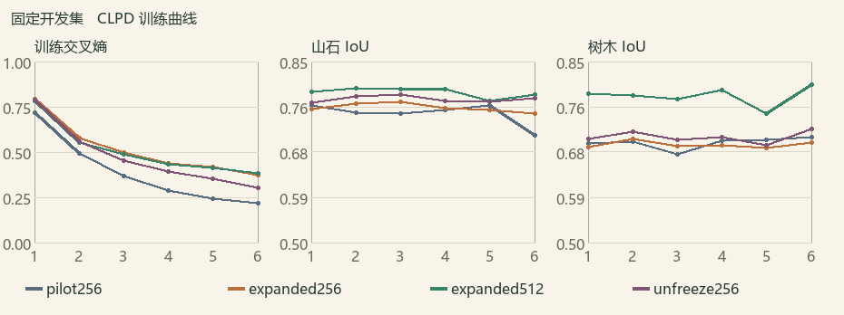

# 2026-11-25 CLPD 扩展与国画视觉迁移训练

本轮推进 G0 数据、G2 树石语义及 G3／G5 数字笔触衔接。扩展训练从 62 张增到 171 张，在相同更新数下完成 4 组 GPU 对照。512 方案的开发集表现最好，但固定评估中的树木 IoU 和树石交界树木 IoU 均低于 S0，候选继续用于研究。

## 数据与分组

- CLPD 固定修订 `54cba6131985352b643d11394663a214dc008c51`。发布索引实读训练 2,000 对、验证 207 对。第一批 164 对，扩展结果为 293 对，净增 195 对，下载和读取校验失败 0 对。图像和掩膜校验尺寸、标签编号和 SHA-256。未将两批的重复文件叠加计数。[CLPD 发布说明](https://huggingface.co/datasets/Rane7/CLP_dataset)
- 固定原 17 张开发、19 张评估。扩展资料覆盖原先 98 张，额外的 195 张中有 86 张因题名组或感知指纹与固定队列冲突而隔离，109 张加入训练。训练、开发、评估各为 26、4、4 个文件名组。`smithsonian` 等只能作为保守分组，不计作已确认作品。原索引中 1,003 个缺作品键的样本继续待核。
- 获取 12 个 Met 公有领域馆藏主图，逐条记录馆藏号、作者或归属、图像地址和哈希。已完成可读取资料交叉筛查，见下节。12 件均已跑冻结模型作定性诊断，缺少事前细粒度参考，未封存为正式独立集。公开 B5 的训练作品清单仍未知。[Met 馆藏入口](https://www.metmuseum.org/art/collection/search/49132)
- [可发布清单](../research/20261125_professional_scale_manifest.json) 保存下载地址、固定划分、馆藏号、原图坐标、全部模型指标和回放哈希。CLPD 掩膜为发布方场景参考。CP28 与吴镇《Crooked Pine》为助手从原图复核的局部参考。未知归属保留，模型预测未用作真值。

## 跨数据集审计

扩展 CLPD、旧 CLPD、可读取项目归档、旧馆藏与画谱页、古画实例分割样图均进入原图筛查。依次检查解码 RGB 的 SHA-256、原向／镜像感知哈希，以及带单目标特征匹配、双侧空间覆盖和非退化仿射约束的 SIFT 裁剪匹配。初版在同一局部上重复命中导致误报，抽看最强候选确认是不同画作，已修正。修正后，12 件新馆藏对 507 条可读取图像记录均无命中。阳性对照从镜像、缩放、调对比后的裁剪找回 156 个一致特征，并重验实例分割样图与历史 `Princeton_127` 解码一致。筛查范围内未命中不能证明全历史素材和公开模型训练作品均无重合，尤其是没有重叠视域的长卷裁片。实例分割发布包本轮只对现有可读样图做 RGB 核查。[实例分割发布页](https://github.com/zpc481523/res-painting)

## 固定预算训练

同一随机种子 20261125，MobileNetV3-Small ImageNet 主干、同一解码头和类别权重，AdamW，解码头学习率 0.002。四组各 6 轮，每轮 26 次更新，等效批量 6。512 组以 2 个 3 张微批累积，交叉熵分母按完整批量有效像素的权重计算。部分解冻只更新最后 3 个编码块，学习率 0.0001，主干 BN 保持评估模式，检查到可训练参数均有梯度。固定末轮统计，数字样张的候选按开发集树石等权平均 IoU 选择。运行于 RTX 5060 Laptop，PyTorch 2.8.0+cu128。单组约 11 至 28 秒，记录的 PyTorch 峰值分配约 83 至 170 MiB，数值不含其他进程、驱动和缓存。

| 方案 | 训练张数 | 开发树／石 IoU | 固定评估树／石 IoU | 评估交界树／石 IoU |
| --- | ---: | ---: | ---: | ---: |
| S0 冻结旧版 | — | 67.0%／72.0% | 66.2%／76.0% | 50.7%／37.8% |
| S2 上轮 | 62 | 68.9%／76.1% | 57.1%／68.8% | 42.0%／39.3% |
| 62 张 256 冻结 | 62 | 70.3%／70.7% | 53.7%／67.7% | 41.0%／36.6% |
| 171 张 256 冻结 | 171 | 69.3%／75.0% | 53.7%／67.5% | 38.3%／34.3% |
| 171 张 512 冻结 | 171 | 80.5%／78.6% | 61.0%／73.7% | 37.8%／44.1% |
| 171 张 256 部分解冻 | 171 | 71.9%／77.9% | 58.5%／71.9% | 39.5%／37.5% |

单独扩数没有提高固定评估树木 IoU。512 组总体提升，树木 Precision／Recall／F1 为 79.5%／72.3%／75.7%，山石为 89.1%／81.1%／84.9%。交界按原图中离另一类 8 px 内的已标树石像素计分，512 组让交界山石提升，但交界树木低于 256 扩展组及 S0。合计指标容易受到单一大组影响，逐作品组分数见清单。固定评估含上一轮确认的 10 张历史重合，单随机种子结果不足以支持接入。



## 馆藏对照、树木和皴法

- 冻结 S0、S2 和 ShanShuiSeg-B5 在 12 件馆藏上生成定性对照。另在 CP28、吴镇松树事前划定的 5 个核心多边形上，S0、S2、B5 的树／石分类召回分别为 35.6%／46.4%、100.0%／21.2%、60.8%／100.0%。S2 明显把岩面收入树区，B5 漏掉部分树身。数字只对应核心参考，不能当作整图或专家准确率。[逐图预测](<E:/Codex_Workspace_Data/CLIPascene_20261021/pro_scale_20261125/prospective_museum_models.png>) · [核心区对照](<E:/Codex_Workspace_Data/CLIPascene_20261021/pro_scale_20261125/reviewed_museum_models.png>)
- B5 锁定发布权重、标签文件及脚本哈希。复用发布的 RGB、均值方差、512×512 双线性整图 Resize、两次双线性上采样和 1–14 类索引约定。这条路径不需要滑窗 padding。保留原生 Torch FP32 前向，14 件作品与上一轮单次上采样路径的原始类别逐像素一致率约 99.82%–99.96%。这验证了两条输入输出路径的差异，官方 MMCV／MMSeg 骨干的逐像素等价仍待验证。[ShanShuiSeg 发布仓库](https://github.com/shengbei4980/ShanShuiSeg)
- CP28 记录 2 个树干核心、1 条主干中心及 4 条一级或二级分枝曲线。吴镇样本记录 1 个树干和 2 个岩面核心。根部墨团、遮挡和交接不明确处保留未知。中心线和父子连接是从静态图推断的参考，完整枝群、树根和笔顺还需另补作品核验。[CP28 原图](https://www.metmuseum.org/art/collection/search/63225) · [松树原图](https://www.metmuseum.org/art/collection/search/41462) · [本轮标记](<E:/Codex_Workspace_Data/CLIPascene_20261021/pro_scale_20261125/object_review.png>)
- 皴法继续保留 40 个历史样本。新增资料证据包括《故宫博物院院刊》图十一的两处长披麻近例和一处融合长披麻、小斧劈语汇的局部，统一作为待复核参考。馆藏《秋声赋图》披麻和斧劈并见，保留作品级混合标签。长短披麻、大小斧劈的新独立教学笔组仍未补齐，因此本轮未拟合 DINOv2 分类、未知拒识或新皴法笔组。[院刊局部图注](https://www.dpm.org.cn/Uploads/File/2021/12/21/u61c14481843d4.pdf) · [秋声赋图馆藏标签](https://digitalarchive.npm.gov.tw/opendata/Pub/Detail/5546?dep=P&mode=full)
- RealBrush 发布页仍显示需登录 Hugging Face、接受资料共享条件并由发布方人工审核。本轮机器端目录请求连接失败，沿用上一轮实际文件请求 401 的获取记录，已获文件仍为 0。获准后可先用同一图的笔迹 JSON、手工墨迹掩膜和逐笔画布建立配对。当前毛笔对照沿用代码中的程序化渲染。[RealBrush 授权页](https://huggingface.co/datasets/madorin0130/pg23-ink-painting-dataset)

## 数字样张与回归

在开发集同一底稿上生成两张各 8 笔的轮廓。S0 及 512 候选均使用 5 条山石、3 条树木区域轮廓。同图可见两者均存在块状闭合、部分轮廓贴到裁片边、树木内部分枝细节丢失。另用 CP28 人工复核的 5 段树形、固定宽度规则及相同层次，比较旧数字毛笔和带状数字毛笔。两项共生成 4 套 JSON、PNG 和逐笔 GIF。实际逐像素重放 22 套历史回放及本轮 4 套，均一致。皴法证据层级的现有 5 项检查通过。500 笔、489 笔与 S0 权重哈希核验通过。当前结果支撑分区到轮廓轨迹的对照，仍需真实拓扑与分笔训练才能开展完整无叶树、岩面皴法和同风格创作。

[8 笔同图对照](<E:/Codex_Workspace_Data/CLIPascene_20261021/pro_scale_20261125/delivery/drawing_comparison.png>) · [512 候选逐笔 GIF](<E:/Codex_Workspace_Data/CLIPascene_20261021/pro_scale_20261125/delivery/expanded512_drawing.gif>) · [CP28 数字毛笔对照](figures/20261125_cp28_brush_comparison.png) · [回放核验明细](<E:/Codex_Workspace_Data/CLIPascene_20261021/pro_scale_20261125/delivery/replay_checks.json>)

## 复现与接入判断

沿用现有 E 盘隔离 Python 与 CUDA 环境。项目内从 `山河绘` 子目录运行，将 `PYTHONPATH` 指向该目录。阶段输出另存 `E:/Codex_Workspace_Data/CLIPascene_20261021/pro_scale_20261125`。训练参数、安装环境标识、分组、曲线、混淆矩阵及权重哈希均保存在清单和本地结果。未启动机械臂或硬件。

```powershell
$env:PYTHONPATH=(Get-Location).Path
$proRoot='E:/Codex_Workspace_Data/CLIPascene_20261021'
$round="$proRoot/pro_scale_20261125"
$python='E:/Anaconda/python.exe'
& $python -B scripts/professional_clpd.py --per-work 32 --works 55 --output "$round/clpd_300" --cache "$proRoot/pro_data_20261125/clpd"
& $python -B scripts/train_professional_scene_scale.py --prepare "$round/clpd_300/manifest.json"
& $python -B scripts/train_professional_scene_scale.py --output "$round/reproduction"
& $python -B scripts/professional_scene_intake.py acquire
& $python -B scripts/professional_scene_intake.py audit
& $python -B scripts/professional_scene_references.py
& $python -B scripts/evaluate_professional_museum.py
& $python -B scripts/professional_scale_delivery.py --comparison "$round/reproduction" --delivery "$round/reproduction_delivery" --publish-manifest "$round/reproduction_manifest.json"
```

下一轮优先为未推理过的新馆藏完成树根、贴岩浅树干和岩纹精标，按整幅作品封存。对已阅馆藏只做开发诊断。进一步用同一训练划分测试整图＋局部高分辨率融合，再决定困难样本训练和拓扑融合是否值得接入。B 线继续从可靠具名局部补足长短披麻、大小斧劈以及跨作品树枝拓扑。现阶段 512 模型仍未通过独立作品验收。
